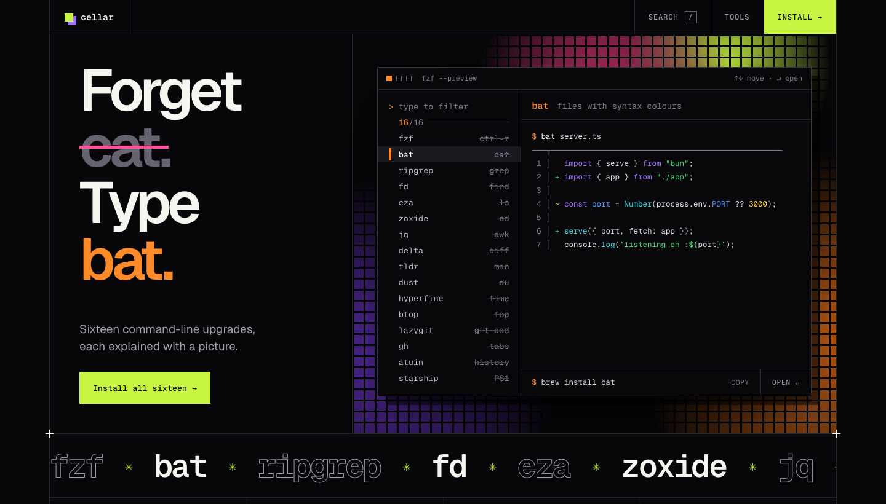

# Cellar

A visual field guide to sixteen Homebrew command-line tools. Each tool gets one picture showing what it does and what it replaces.



**Live site:** https://abhinav-prabhakar.github.io/cellar/

Cellar is a single static page: HTML, CSS and vanilla JavaScript, with no build step and no dependencies. The fonts are self-hosted.

## Features

- **A working fuzzy finder in the hero.** An fzf-style window lists all sixteen tools. Type to filter, move with the arrow keys, press Enter to jump to that tool, and press `/` from anywhere to focus it. The headline ("Forget cat. Type bat.") and the accent colour follow the selected row. The selection auto-advances until you touch it.
- **A bento grid of ten tool cards**, each with one picture. The bat card has a hover-driven before/after line: bat on the left, cat on the right.
- **"Then go deeper"**: five more tools in a list.
- **An install section** with a single `brew install` line for all sixteen tools and three shell setup steps (fzf key bindings, the zoxide hook, delta as git's pager).
- **Click any command to copy it.** Sections reveal as you scroll.


## The sixteen tools

| Tool | Replaces | What it does |
| --- | --- | --- |
| fzf | ctrl-r | Fuzzy-find anything |
| bat | cat | Files with syntax colours |
| ripgrep | grep | Search a whole project |
| fd | find | Find files, sanely |
| eza | ls | Listings with git status |
| zoxide | cd | Jump to any directory |
| jq | awk | Query JSON |
| delta | diff | Readable git diffs |
| tldr (tealdeer) | man | Examples, not manuals |
| dust | du | Disk usage as bars |
| hyperfine | time | Benchmark commands |
| btop | top | System monitor |
| lazygit | git add | Git with a UI |
| gh | tabs | GitHub in the shell |
| atuin | history | Searchable shell history |
| starship | PS1 | A prompt that tells you things |

All sixteen in one line:

```sh
brew install fzf bat ripgrep fd eza zoxide jq git-delta tealdeer dust hyperfine btop lazygit gh atuin starship
```

## A note on the terminal output

The terminal output shown on the site is hand-written, illustrative sample output. It was not captured from real runs, and the numbers in it (timings, sizes, counts) are examples.

## Run locally

Open `index.html` in a browser, or serve the folder:

```sh
python3 -m http.server 4173
# then visit http://localhost:4173
```

## Project structure

```
.
├── index.html          the whole site: markup, styles and script
├── fonts/              self-hosted woff2 files
│   ├── Geist
│   ├── Geist Mono
│   └── Instrument Serif Italic
├── docs/screenshots/   images used in this README
└── .nojekyll           tells GitHub Pages to serve files as-is
```

## Credits

- Fonts: Geist, Geist Mono and Instrument Serif, each under the SIL Open Font License.
- The tools featured here belong to their respective authors; each card links to the project's GitHub page.
- Cellar is unofficial and is not affiliated with Homebrew.
