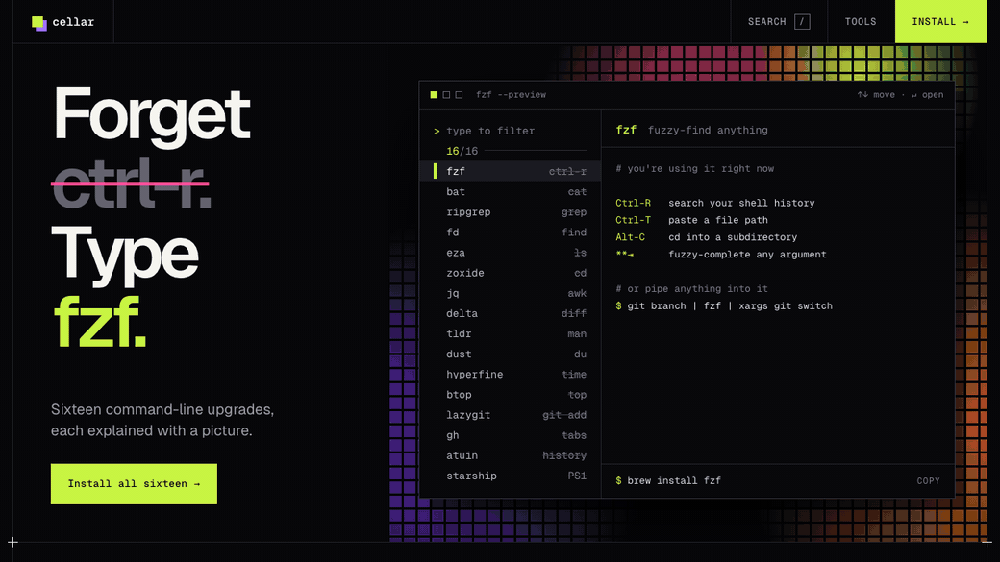
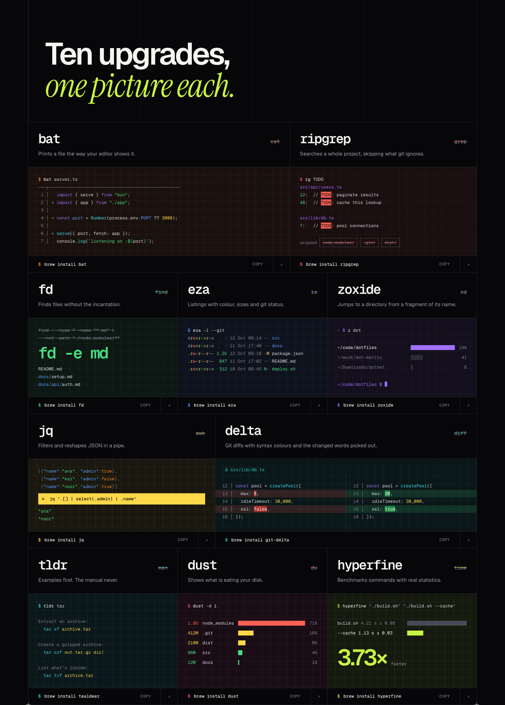
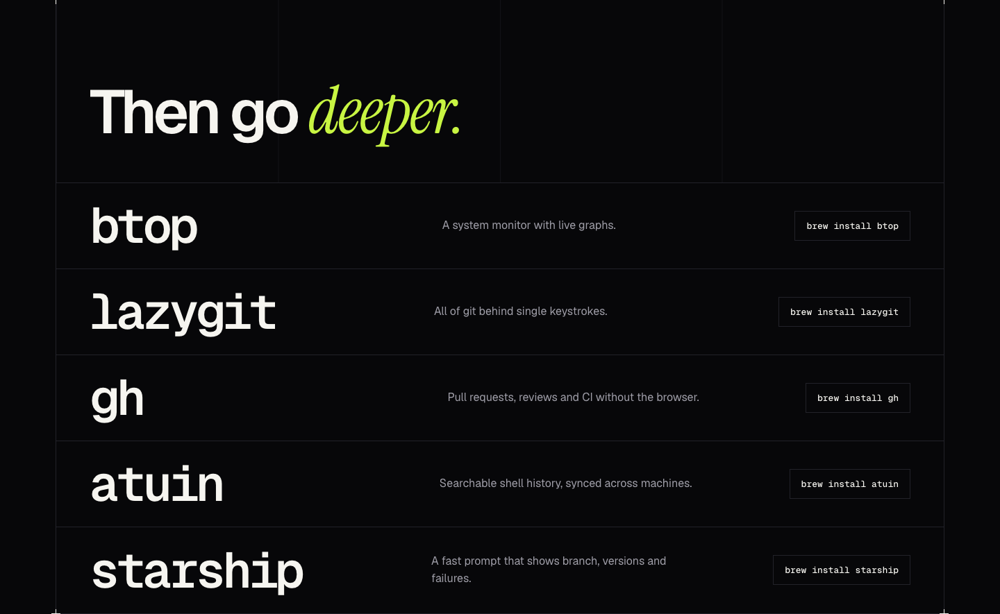
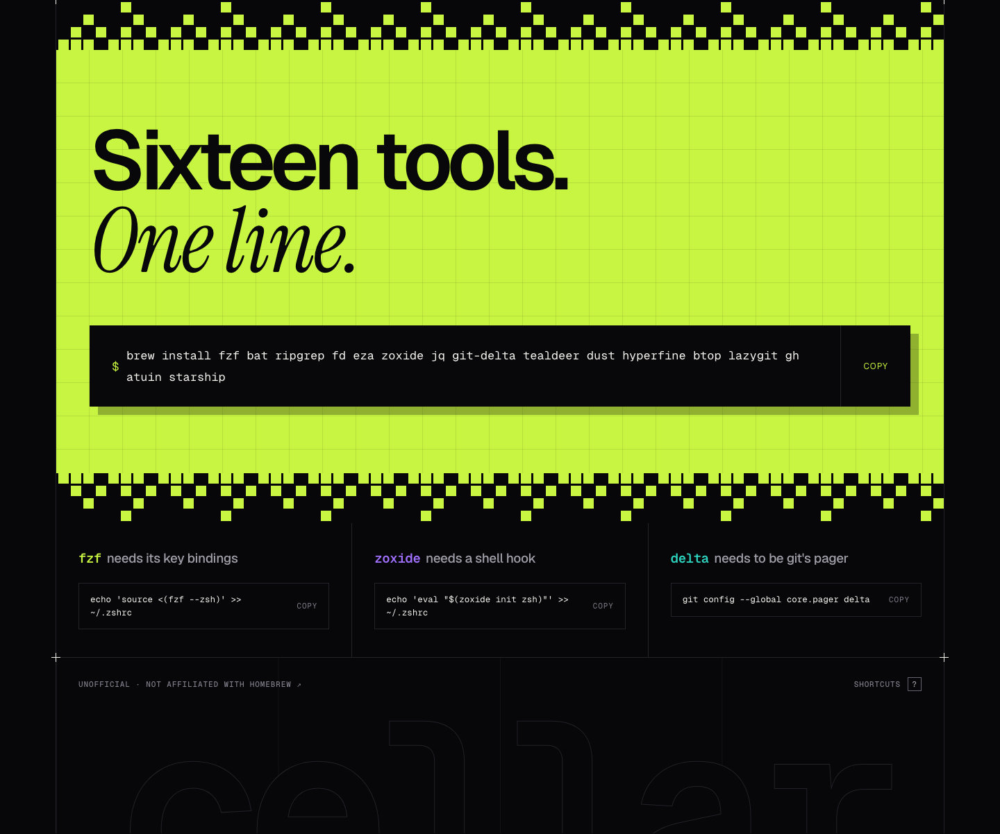

<div align="center">


# Cellar

### Forget `cat`. Type `bat`.

Sixteen Homebrew command-line upgrades, each explained with a picture instead of a man page.

**[Open the live site →](https://abhinav-prabhakar.github.io/Cellar/)**


<a href="https://abhinav-prabhakar.github.io/Cellar/"></a>

</div>

<br>

## The hero is a working fzf

The terminal at the top isn't a screenshot. It is a small fuzzy finder over all sixteen tools, and the headline, the accent colour and the preview pane all follow whichever row is selected.

- **Type** to filter. Matching is fuzzy, so `lg` finds lazygit.
- **Scroll or swipe** to walk the list; it walks itself until you touch it.
- **Enter** jumps to the selected tool further down the page.
- **Every selection is a link.** [`#/rg`](https://abhinav-prabhakar.github.io/Cellar/#/rg) opens on ripgrep with the headline already reading "Forget grep. Type rg." Try [`#/zoxide`](https://abhinav-prabhakar.github.io/Cellar/#/zoxide) or [`#/lazygit`](https://abhinav-prabhakar.github.io/Cellar/#/lazygit).

### Keyboard

| Key | Does |
| :-- | :-- |
| <kbd>/</kbd> | Focus the finder from anywhere |
| <kbd>j</kbd> <kbd>k</kbd> | Next / previous tool, scrolling the page to it |
| <kbd>↑</kbd> <kbd>↓</kbd> | Move within the finder |
| <kbd>Enter</kbd> | Jump to the selected tool |
| <kbd>c</kbd> | Copy the selected tool's install command |
| <kbd>?</kbd> | Show the shortcut sheet |

<br>

## One picture per tool

Ten cards, each with a name, the command it retires, one sentence and one picture. Hover the bat card and a line follows your cursor: `bat` on its left, plain `cat` on its right.



Five bigger tools follow, the kind that take over a whole job.



<br>

## The sixteen

| | Tool | Retires | What it does |
| :-: | :-- | :-- | :-- |
| 01 | [fzf](https://github.com/junegunn/fzf) | `ctrl-r` | Fuzzy-find anything you can pipe |
| 02 | [bat](https://github.com/sharkdp/bat) | `cat` | Files with syntax colours, line numbers and git markers |
| 03 | [ripgrep](https://github.com/BurntSushi/ripgrep) | `grep` | Searches a whole project, skipping what git ignores |
| 04 | [fd](https://github.com/sharkdp/fd) | `find` | Finds files without the incantation |
| 05 | [eza](https://github.com/eza-community/eza) | `ls` | Listings with colour, sizes and git status |
| 06 | [zoxide](https://github.com/ajeetdsouza/zoxide) | `cd` | Jumps to a directory from a fragment of its name |
| 07 | [jq](https://github.com/jqlang/jq) | `awk` | Filters and reshapes JSON in a pipe |
| 08 | [delta](https://github.com/dandavison/delta) | `diff` | Git diffs with the changed words picked out |
| 09 | [tldr](https://github.com/tealdeer-rs/tealdeer) | `man` | Examples first, the manual never |
| 10 | [dust](https://github.com/bootandy/dust) | `du` | Shows what is eating your disk |
| 11 | [hyperfine](https://github.com/sharkdp/hyperfine) | `time` | Benchmarks commands with real statistics |
| 12 | [btop](https://github.com/aristocratos/btop) | `top` | A system monitor with live graphs |
| 13 | [lazygit](https://github.com/jesseduffield/lazygit) | `git add` | All of git behind single keystrokes |
| 14 | [gh](https://github.com/cli/cli) | browser tabs | Pull requests, reviews and CI from the shell |
| 15 | [atuin](https://github.com/atuinsh/atuin) | `history` | Searchable shell history, synced across machines |
| 16 | [starship](https://github.com/starship/starship) | `PS1` | A fast prompt showing branch, versions and failures |

### Install all of them

```sh
brew install fzf bat ripgrep fd eza zoxide jq git-delta tealdeer dust hyperfine btop lazygit gh atuin starship
```

Three of them need one more line each (zsh shown):

```sh
echo 'source <(fzf --zsh)' >> ~/.zshrc          # fzf key bindings: Ctrl-R, Ctrl-T, Alt-C
echo 'eval "$(zoxide init zsh)"' >> ~/.zshrc    # the z command
git config --global core.pager delta            # delta as git's pager
```



<br>

## How it's built

Everything is in [`index.html`](index.html): markup, styles and about 270 lines of vanilla JavaScript. There is no framework, bundler or package.json.

- **Fonts are self-hosted.** Geist, Geist Mono and Instrument Serif live in `fonts/`, so the page works offline.
- **The pictures are HTML.** Every terminal is styled text, not an image, and the hero preview re-uses each card's picture, so nothing is drawn twice.
- **The pixel fields are CSS.** The hero mosaic and the dithered edges of the install block are layered gradients cut by a dark lattice.
- **It respects reduced motion.** With that setting on, the hero stops advancing and the scroll reveals are skipped.
- **It is keyboard and screen-reader friendly.** The finder is a proper combobox and listbox, selections are announced, and there is a skip link.

```
.
├── index.html          the whole site
├── fonts/              three woff2 files
├── favicon.svg
├── og.png              social preview image
└── docs/screenshots/   images used in this README
```

### Run it locally

Open `index.html`, or serve the folder:

```sh
python3 -m http.server 4173
```

<br>

## Honest notes

- The terminal output on the site is hand-written sample output. It was not captured from real runs, and the numbers in it are examples.
- A few tools have no single predecessor, so the "retires" column is a stand-in for those: `awk` for jq, browser tabs for gh, `PS1` for starship.
- Cellar is unofficial and is not affiliated with Homebrew. The tools belong to their authors.
- Fonts: Geist, Geist Mono and Instrument Serif, each under the SIL Open Font License.
